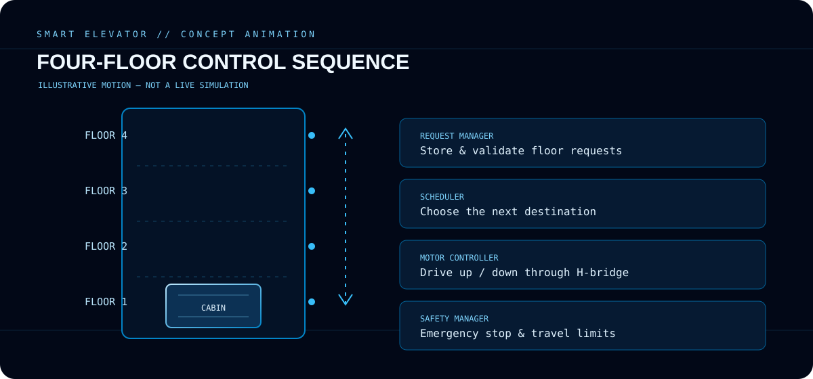

# Smart Elevator Control System

An academic **Computer Organization** project to build a small, working four-floor elevator model using a cardboard structure and real electronic components.

## Animated Concept Preview

<p align="center">
  
</p>

> This is an illustrative animation of the planned four-floor control flow, not a live simulation or proof of implemented firmware behavior.

## Project Snapshot

| Item | Current plan |
|---|---|
| Floors | 4 |
| Approximate vertical height | 80 cm (exact measurement convention to confirm) |
| Cabin / structure | Lightweight cardboard model |
| Main controller | ESP32-S, 38-pin development board |
| Available alternative board | Arduino Uno (not currently planned as a second controller) |
| Movement | One reversible DC geared motor |
| Motor driver | H-bridge selected to match the final motor's voltage and current |
| Floor detection | Position sensors / limit switches, final arrangement to be confirmed |
| Doors | **Out of scope** — the cabin is treated as a controlled block; no door opening/closing mechanism |

This is a working proposal for the team. Motor, driver, power supply, sensor type, dimensions, and scheduling policy must be confirmed after mechanical and electrical checks. Do not treat a product example as an approved purchase.

## Main Goals

- Accept and store cabin and/or floor requests.
- Schedule pending requests and choose the next destination.
- Track the cabin's actual floor using sensors.
- Move the cabin up and down and stop at requested floors.
- Display the current floor, direction, and operating state.
- Provide an emergency stop and travel-limit protection.

## Planned System Modules

| Module | Responsibility |
|---|---|
| Main Elevator Controller | Coordinates state transitions and modules |
| Request Manager | Reads, validates, stores, and clears requests |
| Scheduler | Selects the next floor from pending requests |
| Floor Detection | Identifies floor arrival from physical sensors |
| Motor Control | Drives the DC motor through an H-bridge |
| Safety Manager | Handles emergency stop and upper/lower travel limits |
| Display / User Interface | Reads buttons and displays status |

## High-Level Architecture

```text
Buttons ──> Request Manager ──> Scheduler ──> Main Controller
                                              │
Floor Sensors ──> Floor Manager ──────────────┤
                                              v
                                      Motor Controller
                                              │
                                         H-Bridge
                                              │
                                        DC Geared Motor

Emergency Stop / Limit Protection ──> Safety Manager
Display <── Current Floor / Direction / State
```

## Repository Structure

```text
docs/       Scope, requirements, architecture, and team plan
hardware/   Component list, wiring, and mechanical notes
src/        Firmware source code (to be added)
simulation/ Simulation files (to be added)
tests/      Test cases and verification notes
```

## Getting Started

The project is in the design and planning stage. First agree on requirements and interfaces, then validate the mechanical lift and select the motor/driver based on measured load and current. Firmware implementation follows after pin assignments and module interfaces are agreed.

## Team Workflow

1. Create a branch for each feature or task.
2. Keep commits focused and use clear commit messages.
3. Open a Pull Request to merge work into `main`.
4. Review changes before merging.
5. Update documentation when a design decision changes.

See [CONTRIBUTING.md](CONTRIBUTING.md) and [docs/team-work-plan.md](docs/team-work-plan.md).

## Project Status

🚧 Planning — project scope is narrowed to a four-floor, cardboard elevator model with no door mechanism. Detailed design and component validation are pending.

## Academic Context

Developed as a team project for the Computer Organization course.
